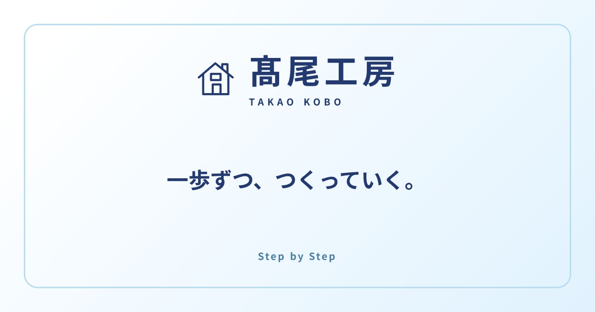

# 髙尾工房

**一歩ずつ、つくっていく。**

Webエンジニアとして制作したものと、日々の学びや暮らしを紹介する個人サイトです。作品の紹介では、「何を作ったか」に加えて、制作の目的や担当したこと、工夫した点も伝えられるようにしています。

[](https://takao-kobo.vercel.app/)

**[公開サイトを見る](https://takao-kobo.vercel.app/)**

## サイトで見られるもの

| ページ | 内容 |
| --- | --- |
| [About me](https://takao-kobo.vercel.app/about) | これまでの歩み、工房を始めた思い、趣味や家族の紹介 |
| [Works](https://takao-kobo.vercel.app/works) | 個人開発・学習課題の作品紹介。制作の目的、担当範囲、工夫、使用技術とその役割 |
| [Blog](https://takao-kobo.vercel.app/blog) | 開発で学んだことや日々の記録。カテゴリで絞り込み、ページを切り替えて読めます |
| [Contact](https://takao-kobo.vercel.app/contact) | メールでのお問い合わせ。メールアプリが開かない場合も、宛先を確認できます |

作品には、登録されている場合に公開サイトやGitHubへのリンクを掲載しています。

## 制作で大切にしたこと

- **工房らしい、少し楽しい入口に。** トップページには階段を上る人物と、カードから顔を出すイラストを配置しました。カードに触れたり選んだりすると、イラストが反応します。
- **スマホでも迷わず操作できるように。** 画面幅に合わせてカードの並びを切り替え、カード全体を押せるようにしています。狭い画面ではイラストを左側に置き、右手で操作するときにも見えやすくしました。詳細ページの下には、ブラウザの下部ボタンとの押し間違いを減らすための余白も設けています。
- **作品の意図や、自分の取り組みを伝える。** Worksは「制作の目的 → 工夫した点 → 主な機能 → 使用技術と役割 → 作品の補足」の順に整理。技術名だけでなく、何のために使ったかも紹介できます。
- **読んだあと、元の場所へ戻りやすく。** ブログの詳細から一覧へ戻ると、カテゴリ・ページ番号・スクロール位置を引き継ぎます。作品一覧でも、詳細を開く前の位置に戻れます。
- **動きの好みにも配慮。** キーボードで操作でき、端末の「動きを減らす」設定に合わせてアニメーションを抑えます。

## サイトを支えるもの

| 技術・サービス | このサイトでの役割 |
| --- | --- |
| Next.js 16 / React 19 / TypeScript | ページの表示と操作の実装 |
| Tailwind CSS v4 | 画面のデザインと、スマホ・PCそれぞれのレイアウト |
| microCMS | 作品紹介とブログ記事の管理 |
| Vercel / Web Analytics | サイトの公開とアクセス傾向の確認 |
| GitHub Actions | 変更時の自動チェック |

## 内容を更新するには

作品とブログは、microCMSで追加・編集します。公開した内容は、サイト側のキャッシュが更新されたあとに反映されます。

| 更新したいもの | 編集する場所 |
| --- | --- |
| 作品の紹介・画像・公開先 | microCMSの `works` |
| ブログ記事・カテゴリ・画像 | microCMSの `blogs` |
| 自己紹介 | `src/app/about/page.tsx` |
| お問い合わせ先 | `src/app/contact/page.tsx` |
| トップページの説明・メニュー | `src/app/page.tsx` / `src/lib/menu.ts` |

作品紹介の書き分けや入力形式は、[コンテンツ更新ガイド](docs/content-guide.md)にまとめています。

## 手元で動かすには

GitとDocker Desktopを用意します。作品・ブログの表示に使うため、microCMSのサービスとAPIキーも必要です。APIの項目は[コンテンツ更新ガイド](docs/content-guide.md)を参照してください。

### 1. リポジトリを取得

```bash
git clone https://github.com/kazuhitotakao/takao-kobo.git
cd takao-kobo
```

### 2. microCMSの接続情報を設定

ルートに `.env.local` を作成し、自分の接続情報を入力します。

```dotenv
MICROCMS_SERVICE_DOMAIN=サービスドメイン
MICROCMS_API_KEY=APIキー
```

### 3. 起動

```bash
docker compose up --build
```

起動時に必要なパッケージが入り、開発サーバーが立ち上がります。[http://localhost:3000](http://localhost:3000)を開いてください。停止は `Ctrl+C` です。

VS Codeでは、Dev Containers拡張機能の「Reopen in Container」からも同じ環境を起動できます。

<details>
<summary>Dockerを使わずに起動する場合</summary>

Node.js 24を用意し、同じように `.env.local` を設定してから実行します。

```bash
npm ci
npm run dev
```

</details>

### 開発時のコマンド

Dockerを使う場合は、コンテナ内のターミナルで実行します。

| コマンド | 内容 |
| --- | --- |
| `npm run dev` | 開発サーバーを起動 |
| `npm run lint` | コードの書き方をチェック |
| `npm run typecheck` | データの扱い方などに型の不整合がないかチェック |
| `npm run build` | 公開用のファイルを作成（microCMSの接続情報が必要） |
| `npm start` | 作成した公開用ファイルでサーバーを起動 |

## 変更を公開するまで

コードの変更は、作業ブランチから `develop` へPRを作成します。`automerge` ラベルを付け、リポジトリの自動マージ設定が有効な場合は、GitHub Actionsのチェック後に統合されます。

本番への公開は、`develop` から `main` へのPRをマージしたときにVercelで行われます。

- [コンテンツ更新ガイド](docs/content-guide.md)：作品・ブログの項目と書き方
- [サイトの保守ガイド](docs/site-maintenance.md)：アクセス解析、検索・SNS共有、公開設定
- [開発作業のルール](AGENTS.md)：ブランチ、コミット、PRの運用
